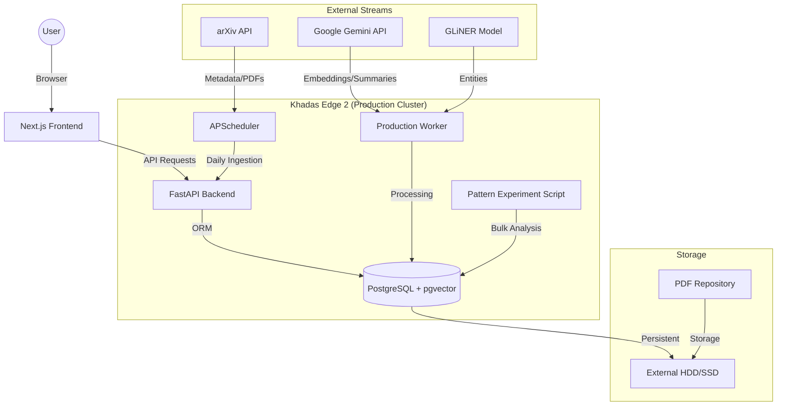

# arXiv Assistant: Holistic Project Summary

## 1. Project Overview
The **arXiv Assistant** is a specialized tool designed for AI researchers to navigate, summarize, and semantically search the massive influx of research papers published daily on arXiv. It automates the entire pipeline from paper discovery to intelligent insight generation, providing a personalized experience through a web dashboard and daily email digests.

---

## 2. Overall Design & Architecture

The system is built as a **Modular Monolith** optimized for deployment on edge devices (specifically the **Khadas Edge 2**) with high performance and reliability.

### System Architecture (Mermaid)

### Component Breakdown
- **Backend Core**: A FastAPI server handling complex search queries, RAG-based chat, and library management.
- **Production Worker**: A background processing engine that handles heavy lifting like PDF text extraction, GLiNER entity extraction, and live embedding generation.
- **Batch Manager**: Specialized scripts for bulk-embedding historical papers (70k+) using asynchronous batch APIs to circumvent live rate limits.
- **Persistent Layer**: PostgreSQL enhanced with `pgvector`. Uses a dual-table strategy for embeddings (`PaperEmbedding` and `PromptTemplate`) to support multiple embedding versions and models.
- **Experiment Lab**: Specialized scripts (`run_pattern_experiment.py`) for large-scale AI research classification using Chain-of-Thought (CoT) prompts.

---

## 3. Features & Implementation

### 3.1 Adaptive Ingestion Pipeline
- **Daily Discovery**: The scheduler fetches new papers every morning based on user-subscribed categories (e.g., `cs.AI`, `cs.LG`).
- **On-Demand Additions**: Users can manually trigger the ingestion of specific papers via arXiv ID or URL (`POST /add`), which immediately fetches metadata and queues the paper for processing.
- **PDF Intelligence**: Papers are downloaded to an external drive. The system extracts the **Abstract** and **Introduction** using `pypdf`, recognizing these as the highest density of useful information.

### 3.2 Intelligent Enrichment
- **High-Dimensional Embeddings**: Transitioned to **3072-dimensional** embeddings using `gemini-embedding-001` for superior semantic representation.
- **Entity Extraction (GLiNER)**: Identifies technical entities (e.g., "Transformer", "RLHF") from paper summaries for specialized filtering.
- **API Robustness**: Implements robust text sanitization (removing null bytes and surrogate pairs) to ensure compatibility with LLM providers.

### 3.3 Researcher Experience
- **Deterministic Dashboard**: A consistent view that preserves scrolling state and paper order.
- **Hybrid Search & RRF**: Combines keyword-based full-text search with semantic vector search. Uses **Reciprocal Rank Fusion (RRF)** to merge results from multiple search strategies into a single, highly relevant list.
- **Semantic Chat**: A RAG interface allowing natural language questions against the entire indexed library.

### 3.4 Citation Analysis & Influence Mapping
- **Reference Extraction**: The production worker extracts structured citations and maps them to local records.
- **Influence Calculation**: Uses a dedicated `CitationLink` table to track local references and calculate "influence" scores based on citation frequency within the library.
- **Large-Scale Experimentation**: Conducts periodic experiments (e.g., 500-paper batches) using V6 CoT prompts to classify papers into complex taxonomies (Agentic, Multi-Agent, World Models, etc.).

---

## 4. Technology Choices & Rationale

| Layer | Technology | Rationale |
| :--- | :--- | :--- |
| **Backend** | **FastAPI** | High-performance async framework ideal for ARM64 edge devices. |
| **Frontend** | **Next.js & Tailwind** | Modern, responsive UI with excellent performance. |
| **AI (Cloud)** | **Google Gemini** | Used for 3072d embeddings and flash-speed summarization. |
| **AI (Local)** | **GLiNER / Ollama** | GLiNER for entity extraction; Ollama for local model experimentation (e.g., Gemma 3). |
| **Database** | **PostgreSQL + pgvector** | Native vector support with RRF ranking capabilities. |
| **Storage** | **External Disk Images** | Portable, high-performance storage for large datasets. |

---

## 5. Deployment Overview
The project is currently deployed on a **Khadas Edge 2 (ARM64)** running Ubuntu. Data is persisted on an **external drive** to handle the storage requirements of a 70k+ paper database and PDF repository.

## Few New Ideas
@claude_feature_ideas.md

## Implementation of few new ideas
@claude_feature_implementations.md
