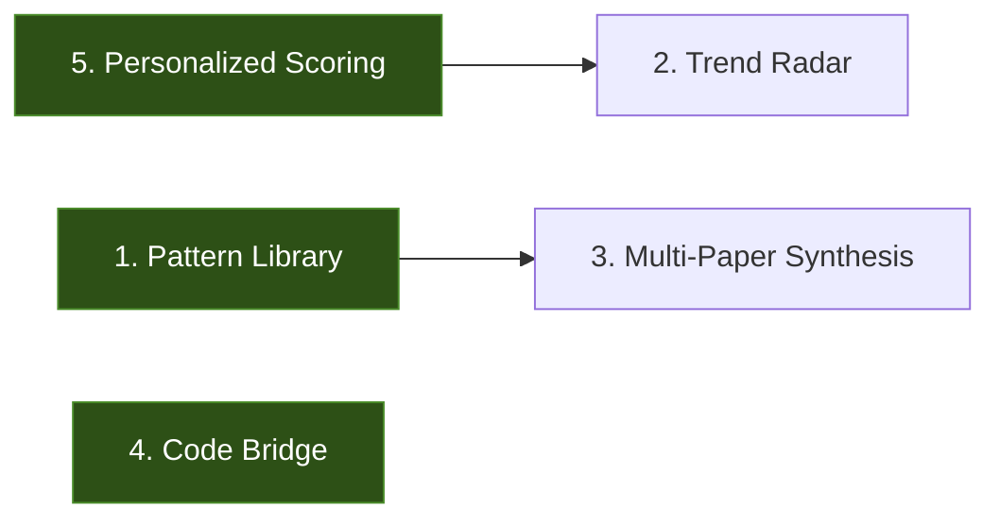

# Implementation Thinking: Top 5 Features

*How each feature maps to your existing stack (FastAPI + PostgreSQL/pgvector + Gemini + Next.js) and what it replaces from your current manual NotebookLM workflow.*

---

## 1. Architecture Pattern Library

**What you're doing manually:** Uploading batches of agent papers to NotebookLM, asking "what patterns does this paper use?", mentally building a taxonomy across sessions.

**Why manual breaks down:** NotebookLM sessions are ephemeral. You lose the accumulated pattern knowledge every time. You can't query across all papers you've ever read.

### Implementation Approach

**Core idea:** Add a structured extraction step to the existing `production_worker.py` pipeline. After summarization, run a second Gemini call that classifies the paper against a **fixed taxonomy** of agentic patterns.

#### The Taxonomy (starter set)

```python
AGENT_PATTERNS = {
    "memory": ["short_term_buffer", "episodic", "rag_based", "working_memory", "long_term_persistent"],
    "planning": ["react_loop", "tree_search", "hierarchical", "goal_decomposition", "chain_of_thought"],
    "tool_use": ["llm_routing", "classifier_routing", "moe_routing", "function_calling", "code_execution"],
    "multi_agent": ["debate", "delegation", "voting", "hierarchical_control", "swarm"],
    "error_recovery": ["retry", "self_reflection", "human_in_loop", "backtracking", "critic_agent"],
    "architecture": ["monolithic", "modular_pipeline", "graph_based", "blackboard", "event_driven"],
}
```

The key insight: **don't let the LLM invent categories**. Give it a fixed taxonomy and ask it to classify. This makes patterns searchable and comparable. Expand the taxonomy over time as new patterns emerge.

#### Backend Changes

```
New DB table: paper_patterns
├── id (PK)
├── paper_id (FK → papers)
├── pattern_category (e.g., "planning")
├── pattern_name (e.g., "react_loop")
├── confidence (float 0-1)
├── evidence_quote (text — the specific passage that justifies the tag)
├── extracted_pseudocode (text, nullable — the pattern's logic in structured form)
└── created_at
```

**Worker addition** (~50 lines in `production_worker.py`):
- After summarization completes, call `llm_service.extract_patterns(full_text, AGENT_PATTERNS)`
- Gemini prompt: structured output (JSON mode) asking "Classify this paper against these patterns. For each match, provide the pattern name, confidence, and a direct quote as evidence."
- Insert results into `paper_patterns` table

**API endpoint**: `GET /papers/patterns?category=planning&name=react_loop`
- Returns papers grouped by pattern with evidence quotes
- Also: `GET /patterns/taxonomy` — returns the full tree for the frontend

**Frontend**: A dedicated "Patterns" page
- Left sidebar: pattern taxonomy tree (expandable)
- Main area: papers matching selected pattern, with evidence quotes
- Pattern detail view: shows all papers using that pattern, plus extracted pseudocode

#### Cost & Performance
- One additional Gemini call per paper (~500 tokens output, structured JSON)
- At current paper volume (~50 papers/day), negligible API cost
- Historical backfill: run a batch job against existing ~63k papers (similar to your existing batch embed pipeline)

---

## 2. Research Trend Radar

**What you're doing manually:** Scrolling through daily digests and mentally noticing "hmm, I'm seeing a lot of MoE papers lately."

**Why manual breaks down:** Human memory is unreliable for frequency detection. You can't notice a 40% increase in a topic you weren't explicitly tracking.

### Implementation Approach

**Core idea:** You already extract `entities` from papers (the `entities` JSON column in `Paper`). Build a **scheduled aggregation job** that counts entity/concept frequency over sliding windows and computes deltas.

#### Backend Changes

```
New DB table: trend_snapshots
├── id (PK)
├── snapshot_date (date — one row per week)
├── window_type ("weekly" | "monthly")
├── concept (string — e.g., "chain_of_thought", "MoE", "speculative_decoding")
├── paper_count (int — papers mentioning this concept in the window)
├── delta_pct (float — % change vs previous window)
└── representative_paper_ids (JSON array — top 3 papers exemplifying this trend)
```

**Two complementary approaches:**

**Approach A — Entity counting (simple, fast):**
- New scheduler job: weekly on Sunday
- Query all papers from the last 7 days, aggregate entity mentions
- Compare to previous week's snapshot
- Calculate delta percentages, flag anything with >30% increase as "trending"
- Store in `trend_snapshots`

**Approach B — Embedding clustering (deeper, catches unnamed trends):**
- Take all paper embeddings from this week
- Run K-means clustering (k=15-20) on the embeddings
- Compare cluster sizes and centers to last week's clusters
- New/growing clusters = emerging trends
- This catches things the entity extractor might miss (unnamed trends that don't have a keyword yet)
- Can run this with scikit-learn directly in Python — no external service needed

I'd recommend **starting with Approach A** (entity counting) because it's simple, interpretable, and you already have the entities data. Add Approach B later as an enhancement.

**API endpoint**: `GET /trends?window=weekly&min_delta=20`

**Frontend**: A "Trends" dashboard page
- Bar chart showing top concepts with ▲/▼ deltas
- Sparkline mini-charts showing each concept's frequency over the last 8 weeks
- Click a trend to see the papers driving it

#### Cost & Performance
- Zero API cost — purely DB aggregation queries
- Runs once per week, takes seconds
- Embedding clustering approach: scikit-learn clustering on 500 papers × 768 dims ≈ <1 second

---

## 3. Multi-Paper Synthesis Chat

**What you're doing manually:** Uploading 5-10 papers to NotebookLM, asking cross-cutting questions, then losing the session.

**Why manual breaks down:** Upload friction, session ephemeral, can't reference your full 63k paper database, can't combine search results with chat.

### Implementation Approach

**Core insight:** Your existing `chat_with_papers` endpoint does single-paper RAG. The upgrade is straightforward — accept a set of paper IDs and use Gemini's massive context window (1M tokens for Flash) to fit multiple full papers.

**Two modes:**

**Mode A — Selected papers (replaces NotebookLM):**
- User selects 3-10 papers from their library/search results
- Backend retrieves full text (abstracts + introductions + summaries) for all selected papers
- Stuffs them into a single Gemini context with clear paper delimiters
- User asks cross-cutting questions: "Compare the memory mechanisms across these papers"

**Mode B — Topic-based auto-retrieval (goes beyond NotebookLM):**
- User asks a question without selecting papers
- Backend does semantic search to find the top 10 most relevant papers
- Stuffs them into context and answers with citations
- This is your existing RAG but with 10 papers instead of 1

#### Backend Changes

```python
# New endpoint in routers/papers.py
@router.post("/papers/synthesis")
async def synthesize_papers(
    paper_ids: List[int],       # Which papers to synthesize across
    query: str,                  # What to ask
    history: List[dict] = [],    # Conversation history (multi-turn)
    db: Session = Depends(get_db)
):
    # 1. Fetch full content for all papers
    papers = db.query(Paper).filter(Paper.id.in_(paper_ids)).all()
    
    # 2. Build multi-paper context
    context = ""
    for p in papers:
        context += f"\n--- PAPER: {p.title} (arxiv: {p.arxiv_id}) ---\n"
        context += f"Abstract: {p.extracted_abstract or p.summary}\n"
        context += f"Introduction: {p.extracted_introduction or ''}\n"
        context += f"AI Summary: {p.generated_summary or ''}\n"
    
    # 3. Call Gemini with the combined context
    # Gemini Flash handles ~1M tokens, so 10 papers is trivial
    response = llm_service.chat(history, query, context)
    
    return {"response": response, "paper_ids": paper_ids}
```

**Frontend changes:**
- In the paper list view, add a "Compare" mode toggle
- User checks 3-10 papers → "Synthesize" button appears
- Opens a chat panel (similar to existing `/chat` page) but scoped to selected papers
- Persistent conversation history so the chat isn't lost

**Key UX detail:** The response should include **inline citations** like `[Paper A: arxiv:2401.12345]` so the user knows which paper each claim comes from.

#### Cost & Performance
- Cost: One Gemini call per message, but with larger context (~10-50k tokens input)
- At Flash pricing, roughly $0.01-0.05 per synthesis query — trivial
- Latency: 2-5 seconds for Gemini to process multi-paper context

---

## 4. Paper → Code Bridge

**What you're doing manually:** Reading a paper, then separately Googling for its GitHub implementation.

**Why manual breaks down:** Not all papers link to code. You have to know where to look. You can't compare implementations across papers.

### Implementation Approach

**Three-layer strategy:**

**Layer 1 — Papers With Code API (automated, immediate):**
- [Papers With Code](https://paperswithcode.com/api/v1) has a public API that maps arXiv IDs to GitHub repos
- Add a scheduled job that queries this API for all papers without code links
- Store results in a new column or table

```
New columns on Paper table (or new table):
├── code_url (string, nullable — GitHub link)
├── code_stars (int, nullable — repo popularity signal)
├── code_framework (string, nullable — "pytorch", "jax", "tensorflow")
└── code_verified_at (datetime — when we last checked)
```

**Worker addition** (~30 lines):
```python
import requests

def resolve_code_link(arxiv_id: str) -> dict | None:
    # Papers With Code API
    resp = requests.get(f"https://paperswithcode.com/api/v1/papers/?arxiv_id={arxiv_id}")
    if resp.ok:
        data = resp.json()
        if data.get("results"):
            paper_pwc = data["results"][0]
            # Get repos for this paper
            repos_resp = requests.get(paper_pwc["url"] + "repositories/")
            if repos_resp.ok and repos_resp.json().get("results"):
                repo = repos_resp.json()["results"][0]  # Highest-starred
                return {
                    "code_url": repo["url"],
                    "code_stars": repo.get("stars", 0),
                    "code_framework": repo.get("framework", "unknown")
                }
    return None
```

**Layer 2 — PDF scraping (catches self-linked repos):**
- Many papers include GitHub links in their text/footnotes
- Extract URLs matching `github.com/*` from the full text during PDF processing
- Already have full_text in the worker — just add a regex

**Layer 3 — LLM pseudocode extraction (for papers without code):**
- For papers with no code link, use Gemini to extract the **core algorithmic contribution** as structured pseudocode
- Prompt: "Extract the key algorithm/architecture from this paper as clear pseudocode. Focus on the novel contribution, not standard boilerplate."
- Store as `extracted_pseudocode` text column

**Frontend:** Add a "Code" tab on the paper detail page
- If GitHub link exists: show repo card (stars, language, framework) with direct link
- If pseudocode extracted: show formatted pseudocode block
- Badge on paper cards: 🔗 (has code) vs 📝 (has pseudocode) vs ∅ (neither)

#### Cost & Performance
- Papers With Code API: free, rate-limited (no auth needed for basic queries)
- PDF URL extraction: zero cost, regex during existing processing
- Pseudocode extraction: one Gemini call per paper (~$0.001 each)
- Historical backfill: batch query Papers With Code for all 63k papers (paginated API calls)

---

## 5. Personalized Relevance Scoring

**What you're doing manually:** Scanning 50+ paper titles daily and deciding which ones to read based on gut feeling.

**Why manual breaks down:** You miss papers that would be highly relevant but have non-obvious titles. Your interests evolve but your filters don't.

### Implementation Approach

**Core idea:** Build a **user interest embedding** from implicit behavior signals, then score new papers by cosine similarity against this profile.

#### Signals to Track

```
New DB table: user_interactions
├── id (PK)
├── user_id (FK)
├── paper_id (FK)
├── interaction_type ("view" | "bookmark" | "search_click" | "chat_reference" | "email_click")
├── weight (float — different interactions = different signal strength)
├── created_at
```

Weights:
| Action | Weight | Rationale |
|---|---|---|
| View paper detail | 1.0 | Mild interest |
| Bookmark | 3.0 | Strong interest |
| Add to custom list | 4.0 | Very strong interest |
| Chat about paper | 5.0 | Deep engagement |
| Search click (from results) | 2.0 | Active seeking |

#### Building the Profile

```python
def compute_user_profile(user_id: int, db: Session) -> List[float]:
    """
    Weighted average of embeddings from papers the user has interacted with.
    Recent interactions weighted higher (time decay).
    """
    interactions = db.query(UserInteraction).filter(
        UserInteraction.user_id == user_id
    ).order_by(UserInteraction.created_at.desc()).limit(200).all()
    
    if not interactions:
        return None
    
    profile = np.zeros(768)  # Match your embedding dimensionality
    total_weight = 0
    
    for interaction in interactions:
        paper = db.query(Paper).get(interaction.paper_id)
        if paper and paper.embedding:
            # Time decay: recent interactions count more
            days_ago = (datetime.utcnow() - interaction.created_at).days
            time_weight = math.exp(-days_ago / 30)  # Half-life of ~30 days
            
            weight = interaction.weight * time_weight
            profile += np.array(paper.embedding) * weight
            total_weight += weight
    
    if total_weight > 0:
        profile = profile / total_weight
        profile = profile / np.linalg.norm(profile)  # Normalize
    
    return profile.tolist()
```

#### Scoring New Papers

This is the beautiful part — **pgvector already supports this**. Once you have the user profile embedding, scoring is just a vector distance query:

```python
# Score papers by relevance to user profile
from pgvector.sqlalchemy import Vector

user_profile = compute_user_profile(user_id, db)

# pgvector cosine distance — lower = more similar
scored_papers = db.query(
    Paper,
    Paper.embedding.cosine_distance(user_profile).label("distance")
).filter(
    Paper.published_date >= cutoff_date
).order_by("distance").limit(20).all()
```

No new infrastructure needed. pgvector does the heavy lifting.

#### Backend Changes

- New middleware/hook in `routers/papers.py`: log interactions to `user_interactions` table (non-blocking, fire-and-forget)
- New scheduled job: daily at 5 AM, recompute user profiles
- New endpoint: `GET /papers/recommended` — returns papers scored against user profile
- Modify existing `GET /papers/` to optionally accept `?personalized=true` to re-rank results

#### Frontend Changes

- Paper cards show a relevance badge: 🎯 95% match
- Dashboard has a "For You" section showing top personalized recommendations
- Settings page: "Reset my preferences" button

#### Cold Start Problem

When the user has no interaction history, fall back to:
1. Their configured categories from `UserConfig`
2. A default "AI + Agents" profile embedding (pre-computed from seed papers)
3. After ~20 interactions, the personalized model kicks in

#### Cost & Performance
- Interaction logging: negligible (one DB insert per action)
- Profile computation: ~200 embedding lookups + weighted average, <100ms
- Scoring: one pgvector query, <50ms (it's designed for this)
- Zero API cost — entirely local computation

---

## Implementation Priority & Dependencies



| Order | Feature | Effort | Dependencies | Immediate Value |
|---|---|---|---|---|
| 1st | **Multi-Paper Synthesis** | ~2 days | None — extends existing chat | Directly replaces your NotebookLM workflow |
| 2nd | **Paper → Code Bridge** | ~2 days | None — additive | Saves daily manual searching |
| 3rd | **Personalized Scoring** | ~3 days | Needs interaction tracking first | Compounds over time |
| 4th | **Pattern Library** | ~4 days | None, but needs taxonomy design | Unique capability, no existing tool does this |
| 5th | **Trend Radar** | ~3 days | Benefits from entity data quality | More useful with larger paper volume |

**My recommendation:** Start with **Multi-Paper Synthesis** — it's the smallest change (one new endpoint + frontend chat panel), directly replaces your NotebookLM workflow, and gives you immediate value. Then **Code Bridge** because it's independent and immediately useful.
